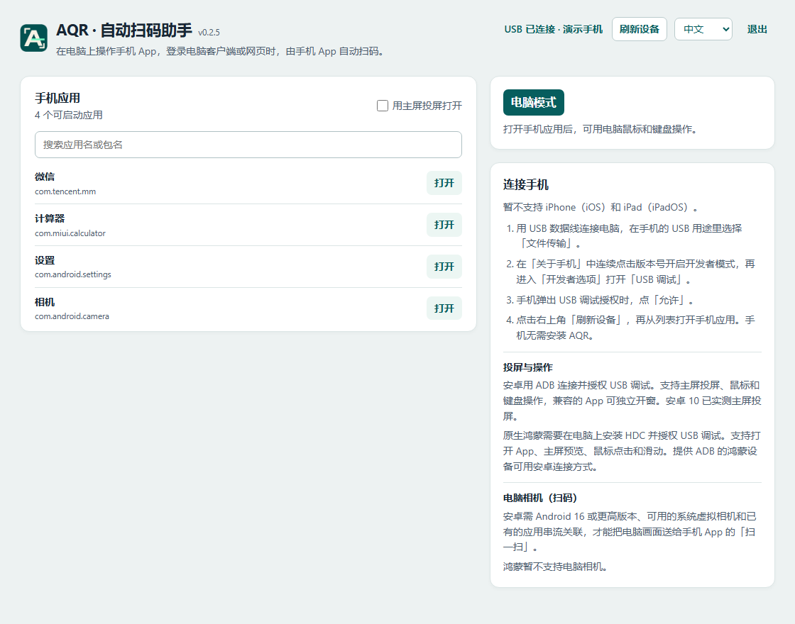

# 自动扫码助手 · Auto QR Assistant（AQR）

在电脑上操作手机 App，登录电脑客户端或网页时，由手机 App 自动扫码。

[中文](#中文) · [English](#english) · [观看演示视频 / Watch the demo](https://joinwell52-ai.github.io/AQR-D/) · [使用反馈 / Feedback](https://github.com/joinwell52-AI/AQR-D/issues/new?template=feedback.yml)

## 中文

### 下载和安装

AQR 当前版本的 Windows 安装版（EXE）和本机 MCP 版均可免费下载和使用。后续版本及新增功能的定价，以对应的发布说明为准。

| 版本 | 下载 | 怎么用 |
| --- | --- | --- |
| Windows 安装版 | [AQR-Setup-x64.exe](https://github.com/joinwell52-AI/AQR-D/releases/download/v0.2.5-setup.1/AQR-Setup-x64.exe) | 可选简体中文或 English、自定义安装目录，并选择创建桌面和开始菜单快捷方式。安装包已包含 Node.js。 |
| 本机 MCP 版 | [npm](https://www.npmjs.com/package/aqr-mcp) · [GitHub 安装包](https://github.com/joinwell52-AI/AQR-D/releases/download/v0.2.5/aqr-mcp-0.2.5.tgz) | 安装后接到支持本机 stdio MCP 的客户端，在聊天里操作。 |

当前为 **Windows x64 0.2.5 预览版**。默认安装到 `%LOCALAPPDATA%\Programs\AQR\0.2.5`。EXE 未签名，可在 [安装器发布页](https://github.com/joinwell52-AI/AQR-D/releases/tag/v0.2.5-setup.1) 核对 SHA-256。

### Windows 桌面版怎么操作

暂不支持 iPhone（iOS）和 iPad（iPadOS）。

首次连接手机时，用 USB 数据线连接电脑，在手机的 USB 用途中选择「文件传输」。在「关于手机」中连续点击版本号开启开发者模式，再进入「开发者选项」打开「USB 调试」。手机弹出授权时点「允许」，再回到 AQR 点「刷新设备」。首次使用默认配置时，AQR 会下载并校验 USB 工具。

#### 1. 主界面



图中使用演示设备和应用列表。

- **右上角「刷新设备」** 重新查找当前 USB 手机。换手机后也用这个按钮。界面语言可切换中文和 English。
- **左侧「手机应用」** 可按名称或包名搜索。以微信为例，搜索「微信」，点旁边的「打开」，即可在独立窗口用电脑鼠标和键盘操作。已打开的窗口在右侧列出，可从那里关闭。
- **右侧「电脑模式」** 用于把电脑二维码送到目标 App 的「扫一扫」。右侧同时提供手机连接说明。

#### 2. 手机应用独立窗口

在「手机应用」里点「打开」后，Windows 会显示标题为「AQR · 应用名」的独立窗口。可在窗口里点按、滚动或输入。用完后关闭该窗口，或在主界面右侧的已打开窗口列表点「关闭」。

#### 3. 用电脑模式扫码登录微信


1. 打开 Windows 微信。如果只显示旧账号的登录按钮，点「切换账号」显示当前登录二维码。点击 AQR 的「电脑模式」，选择手机应用「微信」。
2. 画面来源选「电脑窗口截图」，在「选取窗口」中选中 Windows 微信并点「选取」。在预览里框住登录二维码，保留四周白边。也可用 `Win+Shift+S` 截图，在对话框内用 `Ctrl+V` 粘贴，或选「本地图片」。这些方式均无需 OBS。上图的二维码仅用于演示框选。
3. 点击「打开应用」，在手机微信独立窗口点「＋ → 扫一扫」。若出现登录确认，核对本次登录并确认。Windows 微信显示会话列表后，点击「关闭电脑模式」释放相机会话。

### 本机 MCP

官方 MCP Registry 已登记 `io.github.joinwell52-AI/aqr`。该条目指向 npm 上的本机 stdio 服务。 [查看官方登记](https://registry.modelcontextprotocol.io/?q=io.github.joinwell52-AI%2Faqr)

需要 Windows x64 和带 npm 的 Node.js 24 或更高版本。在 PowerShell 中安装并核对版本：

```powershell
npm install --global aqr-mcp
aqr-mcp --version
```

也可以下载 GitHub 上的 `.tgz`，在下载目录运行 `npm install --global ./aqr-mcp-0.2.5.tgz`。

将以下配置加入支持本机 stdio 的 MCP 客户端。以 Codex 的 TOML 配置为例，先运行 `npm root --global`，再把输出目录填进 `args` 中的路径。

```toml
[mcp_servers.aqr]
command = "node"
args = ["C:/path/to/node_modules/aqr-mcp/bin/launcher.mjs"]
```

#### MCP 工具

| MCP 工具 | 用途 |
| --- | --- |
| `android_qr_open_desktop` | 打开自动扫码助手主界面，或切回已打开的窗口。 |
| `android_qr_probe` | 检测 USB 手机和电脑相机。也可查询本机已保存的方案或双语帮助。 |
| `android_qr_start` | 创建任务或分步执行。可打开手机 App、点按、送码以及保存已验证的方案。 |
| `android_qr_login` | 为已配置的流程自动取码、扫码、确认并核对电脑端结果。Windows 微信需先配置登录后的验证控件。 |
| `android_qr_status` | 查看实时窗口截图、执行进度和登录回执。 |

可以在聊天里说「打开自动扫码助手主界面」「用 AQR 打开手机微信」或「用 AQR 登录电脑微信，看到会话列表后告诉我」。首次登录时提供 Windows 微信的 EXE 路径，宿主可通过 `android_qr_start` 分步执行。配置好微信的登录成功控件后，可改用 `android_qr_login`。只通过 MCP 执行任务时，AQR 桌面主界面可以保持关闭。 [微信 MCP 调用示例](https://www.npmjs.com/package/aqr-mcp)

MCP 在后台检查 npm，并核对官方 GitHub 发布包的摘要。通过自检后，下次启动才启用新版本。现有任务继续执行。向启动参数追加 `--no-update` 可关闭自动更新并使用原安装版本。

### 兼容性和常见问题

| 功能 | 安卓 | 原生鸿蒙 |
| --- | --- | --- |
| 投屏与操作 | 需要 ADB 和已授权的 USB 调试。支持打开 App、主屏投屏、鼠标和键盘操作，兼容的 App 可独立开窗。已在 Android 10 实测主屏投屏。 | 电脑需安装 HDC，手机需授权 USB 调试。桌面版支持打开 App、主屏预览、点击和滑动。 |
| 电脑相机（扫码） | 需要 Android 16 或更高版本、可用的系统虚拟相机和已有的系统应用串流关联。 | 暂不支持。 |

- **找不到手机。** 在手机上确认 USB 用途是「文件传输」，USB 调试已开启并允许当前电脑，然后刷新设备。连接了多台手机时，先保留要操作的一台。
- **HarmonyOS 4.2.0。** 提供 ADB 的机型可使用安卓连接方式。已在一台华为真机上验证 USB 连接、应用列表和图标。
- **需要装手机 APK 吗？** 普通 App 窗口和电脑模式无需在手机安装 AQR APK。
- **扫码后怎样确认？** 以电脑端的结果为准。微信示例以 Windows 微信出现会话列表为验收标志。

## English

Use Android apps on your PC. When you sign in to a desktop app or website, AQR sends the QR image to the Android app so it can scan the code.

### Download and install

The current version of AQR is free to download and use, including the Windows installer (EXE) and the local MCP edition. Pricing for future versions and new features will be stated in the corresponding release notes.

| Edition | Download | How to use it |
| --- | --- | --- |
| Windows installer | [AQR-Setup-x64.exe](https://github.com/joinwell52-AI/AQR-D/releases/download/v0.2.5-setup.1/AQR-Setup-x64.exe) | Choose Simplified Chinese or English, set the installation folder, and select desktop and Start menu shortcuts. Node.js is included. |
| Local MCP | [npm](https://www.npmjs.com/package/aqr-mcp) · [GitHub package](https://github.com/joinwell52-AI/AQR-D/releases/download/v0.2.5/aqr-mcp-0.2.5.tgz) | Connect a client that supports local stdio MCP and control AQR from chat. |

The current **Windows x64 preview is 0.2.5**. The default installation folder is `%LOCALAPPDATA%\Programs\AQR\0.2.5`. The installer is unsigned and its SHA-256 checksum is available on the [installer release page](https://github.com/joinwell52-AI/AQR-D/releases/tag/v0.2.5-setup.1).

### Using the Windows desktop app

iPhone (iOS) and iPad (iPadOS) are not supported.

Connect the phone with a USB data cable and select **File transfer** in the phone’s USB options. In **About phone**, tap **Build number** repeatedly to enable developer mode. Then turn on **USB debugging** in **Developer options**, tap **Allow** if prompted, and select **Refresh device** in AQR. On first use with the default configuration, AQR downloads and verifies its USB tools.

1. **Main window.** Select **Refresh device** to detect the current USB phone. Search for WeChat and click **Open** to use it in a separate window. The right panel lists open windows and contains the connection guide.
2. **PC Mode.** Display the sign-in QR code in WeChat for Windows. Choose **Switch account** if only the previous account’s sign-in button is visible. In AQR, open **Computer mode**, select WeChat as the phone app, capture the Windows WeChat window, and crop to the QR code with its white margin. You can also capture with `Win+Shift+S` and paste with `Ctrl+V`, or select a local image. These options work without OBS.
3. **Scan.** Click **Open app** and select **+ → Scan** in the phone’s WeChat window. Review and confirm any sign-in prompt. Once the chat list appears in WeChat for Windows, select **Close PC Mode**.

### Local MCP setup

The official MCP Registry lists `io.github.joinwell52-AI/aqr` and links it to the local stdio service on npm. [Registry entry](https://registry.modelcontextprotocol.io/?q=io.github.joinwell52-AI%2Faqr)

MCP requires Windows x64 and Node.js 24 or later with npm. Install it from npm:

```powershell
npm install --global aqr-mcp
aqr-mcp --version
```

For the GitHub download, run `npm install --global ./aqr-mcp-0.2.5.tgz` in the download folder. For a Codex TOML configuration example, see the Chinese setup above. The launcher is `aqr-mcp/bin/launcher.mjs` under the directory returned by `npm root --global`.

#### MCP tools

| MCP tool | Purpose |
| --- | --- |
| `android_qr_open_desktop` | Open the Auto QR Assistant main window or switch to it. |
| `android_qr_probe` | Detect the USB phone and PC camera, or retrieve saved plans and bilingual help. |
| `android_qr_start` | Create a task or run individual actions such as opening an app, clicking, feeding a code, or saving a verified plan. |
| `android_qr_login` | Capture a code, scan it, confirm the sign-in, and verify the PC result for configured flows. WeChat for Windows needs a configured signed-in control. |
| `android_qr_status` | Get a current window screenshot, progress, or a sign-in receipt. |

Try “Open the Auto QR Assistant main window,” “Open WeChat on my phone with AQR,” or “Use AQR to sign in to WeChat for Windows and tell me when the chat list appears.” For initial setup, provide the Windows WeChat EXE path so the host can run the steps through `android_qr_start`. Once the signed-in control has been configured, use `android_qr_login`. The main desktop window can stay closed during a chat-driven task. [WeChat MCP example](https://www.npmjs.com/package/aqr-mcp)

MCP checks npm for updates in the background and cross-checks the archive against the official GitHub release. A verified update takes effect at the next start. Running tasks continue. Add `--no-update` to use the version you installed and disable update checks.

### Compatibility and troubleshooting

| Feature | Android | Native HarmonyOS |
| --- | --- | --- |
| Mirroring and control | Uses ADB and authorized USB debugging. Open apps, mirror the main screen with mouse and keyboard control, or open compatible apps in separate windows. Main-screen mirroring was tested on Android 10. | Install HDC on the PC and authorize USB debugging. The desktop app can launch apps and preview the main screen with click and swipe control. |
| Computer camera for QR scanning | Requires Android 16 or later, a working system virtual camera, and an existing system app streaming association. | Currently unavailable. |

- If AQR cannot find your phone, select **File transfer**, verify that USB debugging is on and that the PC is authorized, then refresh devices. Connect one phone at a time.
- HarmonyOS devices with ADB can use the Android connection. USB connection, app listing, and icons were verified on a Huawei phone running HarmonyOS 4.2.0.
- Standard app windows and PC Mode work without installing the AQR APK on the phone.
- Verify the result on the PC. For WeChat, look for the chat list in the Windows client.
