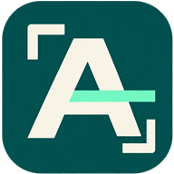

# 自动扫码助手 · Auto QR Assistant（AQR）

在电脑上操作手机 App，登录电脑客户端或网页时，由手机 App 自动扫码。

[中文](#中文) · [English](#english)

## 中文

### 下载

Windows x64 首个预览版为 0.2.0。所有下载文件和 SHA-256 校验值见 [发布页](https://github.com/joinwell52-AI/AQR-Distribution/releases/tag/v0.2.0)。

AQR 当前版本的 Windows 安装版（EXE）和本机 MCP 版均可免费下载和使用。后续版本及新增功能的定价，以对应的发布说明为准。

| 版本 | 下载和使用 |
| --- | --- |
| Windows 安装版（EXE） | [下载安装包](https://github.com/joinwell52-AI/AQR-Distribution/releases/download/v0.2.0/AQR-Setup-x64.exe)。安装包内置 Node.js，运行后从开始菜单打开 **Auto QR Assistant**。 |
| 本机 MCP 版 | [下载 MCP 包](https://github.com/joinwell52-AI/AQR-Distribution/releases/download/v0.2.0/aqr-mcp-0.2.0.tgz)。需要 Node.js 24 和 npm。运行 `npm install -g ./aqr-mcp-0.2.0.tgz`，再把 `aqr-mcp` 作为本机 stdio 服务接入客户端。 |

MCP 在后台核对 npm 和官方发布页上的同版包，通过自检后在下次启动时启用更新。使用 `--no-update` 可保留原安装版本。

### 使用

1. 在安卓手机上开启开发者选项和 USB 调试，用数据线连接 Windows 电脑，并在手机上允许这台电脑调试。
2. 桌面版从 Windows 开始菜单打开。在 AQR 里刷新设备，选一个手机 App，即可在独立窗口用鼠标和键盘操作。
3. 扫码登录时，使用「电脑模式」选取窗口截图或粘贴二维码，再进入手机 App 的「扫一扫」。截图和粘贴图片无需 OBS。
4. 使用 MCP 版时，按发布包附带的说明连接客户端。连接后可以说「打开自动扫码助手主界面」或「用 AQR 自动登录交管 12123 单位用户入口」。已验证的登录步骤和执行进度可在本机查询。

**兼容性**　普通手机 App 窗口需要可用的 USB 调试连接。电脑模式还需要 Android 16 或更高版本，以及手机上已有的系统应用串流关联。交管 12123 单位用户扫码登录已在小米 14 Pro 上验证。AQR 桌面界面可在简体中文和英文之间切换。

## English

Use Android apps on your PC. When you sign in to a desktop app or website, AQR sends the QR image to the Android app so it can scan the code.

### Downloads

The first Windows x64 preview is 0.2.0. See the [release page](https://github.com/joinwell52-AI/AQR-Distribution/releases/tag/v0.2.0) for all downloads and SHA-256 checksums.

The current version of AQR is free to download and use, including the Windows installer (EXE) and the local MCP edition. Pricing for future versions and new features will be stated in the corresponding release notes.

| Edition | Download and use |
| --- | --- |
| Windows installer (EXE) | [Download the Windows installer](https://github.com/joinwell52-AI/AQR-Distribution/releases/download/v0.2.0/AQR-Setup-x64.exe). It includes Node.js. After installation, open **Auto QR Assistant** from the Start menu. |
| Local MCP | [Download the MCP package](https://github.com/joinwell52-AI/AQR-Distribution/releases/download/v0.2.0/aqr-mcp-0.2.0.tgz). With Node.js 24 and npm, run `npm install -g ./aqr-mcp-0.2.0.tgz`, then register `aqr-mcp` as a local stdio server. |

MCP checks npm for updates in the background and cross-checks the archive against the official release. A verified update takes effect at the next start. Use `--no-update` to keep the installed version.

### Getting started

1. Enable Developer options and USB debugging on your Android phone. Connect it to your Windows PC with a data cable and authorize the PC on the phone.
2. Open the desktop edition from the Windows Start menu. Refresh devices in AQR and select an Android app to use it in a separate window with your mouse and keyboard.
3. For QR sign-in, use PC Mode to capture a window or paste a QR image, then open the Android app's scanner. Screenshots and pasted images work without OBS.
4. For the MCP edition, follow the setup instructions included with the release. Once connected, try “Open the Auto QR Assistant main window” or “Use AQR to sign in to the 12123 organization portal.” Verified sign-in steps and run progress can be reviewed locally.

**Compatibility**　Standard app windows require a working USB debugging connection. PC Mode also requires Android 16 or later and an existing system app streaming association. Organization QR sign-in for 12123 has been verified on a Xiaomi 14 Pro. The AQR desktop interface supports Simplified Chinese and English.
