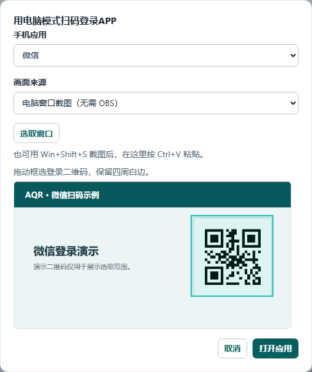

# 自动扫码助手 · Auto QR Assistant（AQR）

在电脑上操作手机 App，登录电脑客户端或网页时，由手机 App 自动扫码。

[中文](#中文) · [English](#english)

## 中文

### 下载和安装

AQR 当前版本的 Windows 安装版（EXE）和本机 MCP 版均可免费下载和使用。后续版本及新增功能的定价，以对应的发布说明为准。

| 版本 | 下载 | 怎么用 |
| --- | --- | --- |
| Windows 安装版 | [AQR-Setup-x64.exe](https://github.com/joinwell52-AI/AQR-Distribution/releases/download/v0.2.1/AQR-Setup-x64.exe) | 安装后从开始菜单打开 **Auto QR Assistant**。安装包已包含 Node.js。 |
| 本机 MCP 版 | [npm](https://www.npmjs.com/package/aqr-mcp) · [GitHub 安装包](https://github.com/joinwell52-AI/AQR-Distribution/releases/download/v0.2.1/aqr-mcp-0.2.1.tgz) | 安装后接到支持本机 stdio MCP 的客户端，在聊天里操作。 |

当前为 **Windows x64 0.2.1 预览版**。EXE 未做 Windows 代码签名，下载文件可在 [发布页](https://github.com/joinwell52-AI/AQR-Distribution/releases/tag/v0.2.1) 核对 SHA-256。

### Windows 桌面版怎么操作

首次连接手机时，在安卓手机的「开发者选项」中打开「USB 调试」，用能传数据的 USB 线连接，并在手机上允许这台电脑调试。首次使用默认配置时，AQR 会下载并校验 USB 工具。

#### 1. 主界面


图中使用 0.2.0 的演示数据。0.2.1 的桌面操作一致。

- **右上角「刷新设备」** 重新查找当前 USB 手机。换手机后也用这个按钮。界面语言可切换中文和 English。
- **左侧「手机应用」** 可按名称或包名搜索。点击应用旁的「打开」，用电脑鼠标和键盘操作，例如打开计算器或交管 12123。已打开的窗口在右侧列出，可从那里关闭。
- **右侧「电脑模式」** 用于把电脑二维码送到目标 App 的「扫一扫」。右侧同时提供手机连接说明。

#### 2. 手机应用独立窗口

在「手机应用」里点「打开」后，Windows 会显示标题为「AQR · 应用名」的独立窗口。可在窗口里点按、滚动或输入。用完后关闭该窗口，或在主界面右侧的已打开窗口列表点「关闭」。

#### 3. 电脑模式扫码登录



1. 在浏览器或电脑客户端打开登录二维码。点击 AQR 的「电脑模式」，选择手机 App。
2. 画面来源可用「电脑窗口截图」「本地图片」或「OBS 当前画面」。使用窗口截图时点「选取窗口」，选中目标窗口并点「选取」，在预览里框住登录二维码并保留四周白边。也可先用 `Win+Shift+S` 截图，再在对话框内用 `Ctrl+V` 粘贴。截图和粘贴均无需 OBS。
3. 点击「打开应用」，在 App 内进入「扫一扫」。完成本轮操作后，可点击「关闭电脑模式」释放相机会话。

### 本机 MCP

需要 Windows x64 和带 npm 的 Node.js 24 或更高版本。在 PowerShell 中安装并核对版本：

```powershell
npm install --global aqr-mcp
aqr-mcp --version
```

也可以下载 GitHub 上的 `.tgz`，在下载目录运行 `npm install --global ./aqr-mcp-0.2.1.tgz`。

将以下配置加入支持本机 stdio 的 MCP 客户端。以 Codex 的 TOML 配置为例，先运行 `npm root --global`，再把输出目录填进 `args` 中的路径。

```toml
[mcp_servers.aqr]
command = "node"
args = ["C:/path/to/node_modules/aqr-mcp/bin/launcher.mjs"]
```

#### MCP 工具

| MCP 工具 | 用途 |
| --- | --- |
| `android_qr_open_desktop` | 打开自动扫码助手主界面，或切回已打开的窗口。 |
| `android_qr_probe` | 检测 USB 手机和电脑相机。也可查询本机已保存的方案或双语帮助。 |
| `android_qr_start` | 创建任务或分步执行。可打开手机 App、点按、送码以及保存已验证的方案。 |
| `android_qr_login` | 自动取码、扫码、确认并核对电脑端结果。交管 12123 单位用户是可直接执行的流程。 |
| `android_qr_status` | 查看实时窗口截图、执行进度和登录回执。 |

可以在聊天里说「打开自动扫码助手主界面」「用 AQR 打开手机计算器」或「用 AQR 自动登录交管 12123 单位用户入口」。只通过 MCP 执行任务时，AQR 桌面主界面可以保持关闭。

MCP 在后台检查 npm，并核对官方 GitHub 发布包的摘要。通过自检后，下次启动才启用新版本。现有任务继续执行。向启动参数追加 `--no-update` 可关闭自动更新并使用原安装版本。

### 兼容性和常见问题

- **找不到手机。** 确认数据线支持传输，手机已允许当前电脑 USB 调试，然后刷新设备。连接了多台手机时，先保留要操作的一台。
- **需要装手机 APK 吗？** 普通 App 窗口和电脑模式无需在手机安装 AQR APK。
- **可以打开应用，但手机收不到电脑画面。** 电脑模式需要 Android 16 或更高版本，以及手机上已有的系统应用串流关联。交管 12123 单位用户扫码登录已在小米 14 Pro 上验证。
- **扫码后怎样确认？** 电脑页面的结果才是验收依据。例如交管 12123 单位用户入口出现「请选择单位」时，AQR 会记录登录成功。

## English

Use Android apps on your PC. When you sign in to a desktop app or website, AQR sends the QR image to the Android app so it can scan the code.

### Download and install

The current version of AQR is free to download and use, including the Windows installer (EXE) and the local MCP edition. Pricing for future versions and new features will be stated in the corresponding release notes.

| Edition | Download | How to use it |
| --- | --- | --- |
| Windows installer | [AQR-Setup-x64.exe](https://github.com/joinwell52-AI/AQR-Distribution/releases/download/v0.2.1/AQR-Setup-x64.exe) | Install and open **Auto QR Assistant** from the Start menu. Node.js is included. |
| Local MCP | [npm](https://www.npmjs.com/package/aqr-mcp) · [GitHub package](https://github.com/joinwell52-AI/AQR-Distribution/releases/download/v0.2.1/aqr-mcp-0.2.1.tgz) | Connect a client that supports local stdio MCP and control AQR from chat. |

The current **Windows x64 preview is 0.2.1**. The installer is unsigned. SHA-256 checksums are on the [release page](https://github.com/joinwell52-AI/AQR-Distribution/releases/tag/v0.2.1).

### Using the Windows desktop app

Enable Developer options and USB debugging on your Android phone. Connect it with a USB data cable and authorize the computer when prompted. On first use with the default configuration, AQR downloads and verifies its USB tools.

1. **Main window.** Select **Refresh device** to detect the current USB phone. Search the app list by name or package name and click **Open**. Use the separate app window with your mouse and keyboard. The right panel also lists open windows and contains the connection guide.
2. **PC Mode.** Open the sign-in QR code in the target Windows app or website. In AQR, open **Computer mode**, choose the Android app and select a window screenshot, local image, or live OBS output. For a window screenshot, select the window and crop to the login QR code, keeping its white margin. You can also capture with `Win+Shift+S` and paste with `Ctrl+V`. Screenshots and pasted images work without OBS.
3. **Scan.** Click **Open app**, open the scanner inside the Android app, and complete the sign-in. Select **Close PC Mode** after use.

### Local MCP setup

MCP requires Windows x64 and Node.js 24 or later with npm. Install it from npm:

```powershell
npm install --global aqr-mcp
aqr-mcp --version
```

For the GitHub download, run `npm install --global ./aqr-mcp-0.2.1.tgz` in the download folder. For a Codex TOML configuration example, see the Chinese setup above. The launcher is `aqr-mcp/bin/launcher.mjs` under the directory returned by `npm root --global`.

#### MCP tools

| MCP tool | Purpose |
| --- | --- |
| `android_qr_open_desktop` | Open the Auto QR Assistant main window or switch to it. |
| `android_qr_probe` | Detect the USB phone and PC camera, or retrieve saved plans and bilingual help. |
| `android_qr_start` | Create a task or run individual actions such as opening an app, clicking, feeding a code, or saving a verified plan. |
| `android_qr_login` | Capture a code, scan it, confirm the sign-in, and verify the PC result for configured flows. |
| `android_qr_status` | Get a current window screenshot, progress, or a sign-in receipt. |

Try “Open the Auto QR Assistant main window,” “Open the phone calculator with AQR,” or “Use AQR to sign in to the 12123 organization portal.” The main desktop window can stay closed during a chat-driven task.

MCP checks npm for updates in the background and cross-checks the archive against the official GitHub release. A verified update takes effect at the next start. Running tasks continue. Add `--no-update` to use the version you installed and disable update checks.

### Compatibility and troubleshooting

- If AQR cannot find your phone, check the USB data cable and debugging authorization, then refresh devices. Connect one phone at a time.
- Standard app windows and PC Mode work without installing the AQR APK on the phone.
- PC Mode requires Android 16 or later and an existing system app streaming association. Organization QR sign-in for 12123 was verified on a Xiaomi 14 Pro.
